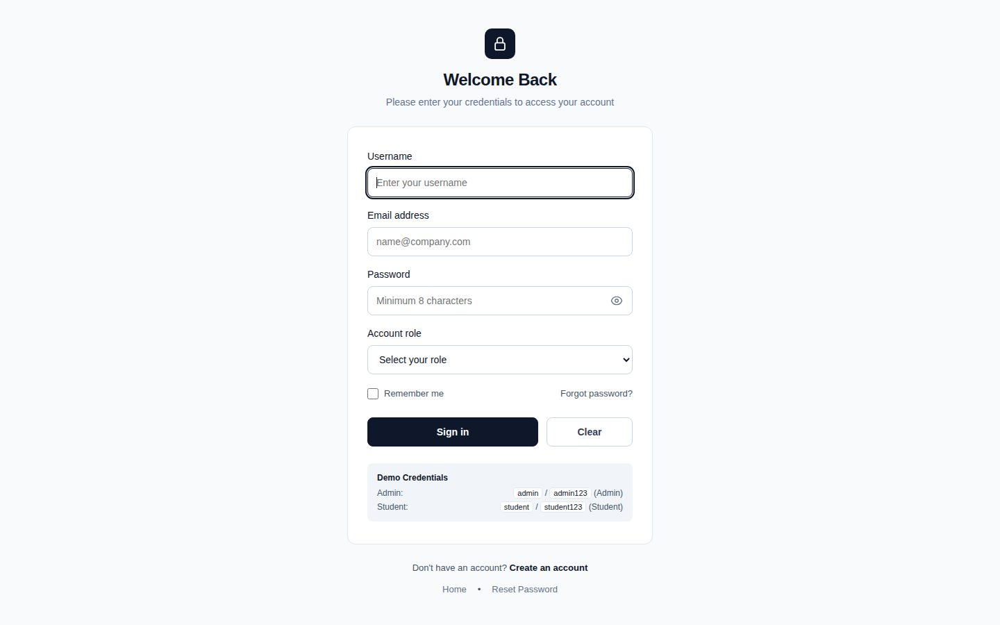
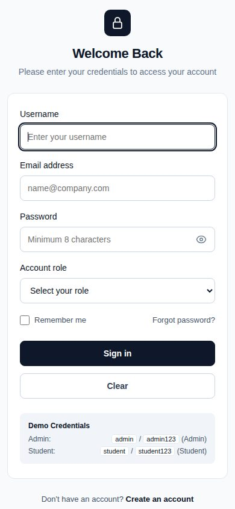

# 🔐 Simple Login Page

A clean, accessible, and responsive login interface built with semantic **HTML5**, modern **CSS3**, and minimal vanilla **JavaScript**. Designed following anti-slop, high-standard frontend principles, this project demonstrates clean UI design, solid typographic hierarchy, keyboard accessibility, and a cohesive user authentication flow suitable for portfolio showcase.

---

## 📸 Preview

### Desktop View


### Mobile View
<p align="center">
  
</p>

---

## ✨ Features

- **Modern & Professional UI:** Minimalist aesthetic with high-contrast text, clear visual hierarchy, and clean surface separation without heavy artificial shadows.
- **Accessible & Semantic Markup:** Built with semantic HTML elements (`<main>`, `<header>`, `<section>`, `<form>`, `<label>`, `<nav>`, `<aside>`) with complete `for`/`id` associations and accessible labels.
- **Visible Keyboard Focus States:** Native, accessible `:focus-visible` outlines ensure keyboard-only navigation is straightforward and visible.
- **Show / Hide Password Toggle:** Accessible password visibility toggle button with ARIA attributes and SVG icons.
- **Client-Side Demo Validation:** Interactive form handling with live status feedback banners for missing fields, role mismatches, and successful logins.
- **Demo Credentials Helper:** Built-in demo accounts to easily test and explore role-based redirection:
  - **Admin:** `admin` / `admin123` (Role: Admin)
  - **Student:** `student` / `student123` (Role: Student)
- **Complete Auth Pages:**
  - `login.html` – Primary login and role selection page.
  - `create.html` – Account registration page.
  - `forgot.html` – Password reset page.
  - `container.html` – Post-login projects dashboard.
  - `index.html` – Platform landing page.
- **Fully Responsive:** Custom layout crafted for seamless display across mobile (390px+), tablet (768px), and desktop (1440px+) screen widths.
- **Zero External Dependencies:** 100% vanilla HTML, CSS, and JavaScript—no heavy CSS frameworks, bundlers, or third-party libraries required.

---

## 🛠️ Technologies Used

- **HTML5:** Semantic document structuring, form controls, and accessibility metadata.
- **CSS3:** Custom design tokens (CSS variables), modern flexbox/grid layouts, responsive media queries, and transition states.
- **Vanilla JavaScript:** Client-side interaction (password toggle, form event handling, and demo credential routing).

---

## 📂 Project Structure

```text
Login/
├── index.html               # Platform landing page
├── login.html               # Main login page with demo authentication
├── create.html              # Account registration / sign-up page
├── forgot.html              # Password reset interface
├── container.html           # Projects dashboard (post-login view)
├── style.css                # Unified stylesheet and design system
├── screenshots/             # Interface preview screenshots
│   ├── login-desktop.jpg    # Desktop render preview
│   └── login-mobile.jpg     # Mobile render preview
├── .gitignore               # Git ignore configuration
└── README.md                # Project documentation
```

---

## 🚀 Getting Started

No build tools or server setup are required. You can run this project locally in seconds:

### 1. Clone the Repository
```bash
git clone https://github.com/sabith-todo/Login.git
cd Login
```

### 2. Open in Your Browser
Simply double-click `login.html` (or `index.html`) to open it directly in any web browser:
```bash
# On Linux
xdg-open login.html

# On macOS
open login.html

# On Windows
start login.html
```

Alternatively, serve it with any local static development server:
```bash
npx serve .
# or use VS Code "Live Server" extension
```

---

## 🧪 Testing the Demo Login

To test the demo login flow on `login.html`:

1. Enter **Username**: `admin`, **Email**: `admin@example.com`, **Password**: `admin123`, and select **Role**: `Admin`.
2. Click **Sign in**.
3. A success confirmation banner will appear, redirecting you to `container.html` (the projects dashboard).
4. You can also test with the **Student** credentials (`student` / `student123` with role `Student`).
5. Entering mismatched credentials or wrong roles will display an informative validation error banner.

---

## 🔮 Future Improvements

- [ ] Connect with a real backend service (Node.js / Express or Python FastAPI).
- [ ] Implement secure password hashing (bcrypt / Argon2) and database persistence.
- [ ] Implement JWT (JSON Web Tokens) or session cookie-based authentication.
- [ ] Add OAuth2 social sign-in providers (Google, GitHub).
- [ ] Add two-factor authentication (2FA / TOTP).

---

## 👨‍💻 Author

**Sabith**  
Frontend & AI Development Enthusiast  
GitHub: [@sabith-todo](https://github.com/sabith-todo)

---

## 📄 License

This project is open source and available for educational, learning, and portfolio demonstration purposes.
